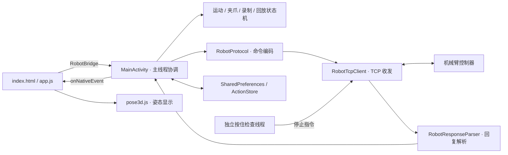
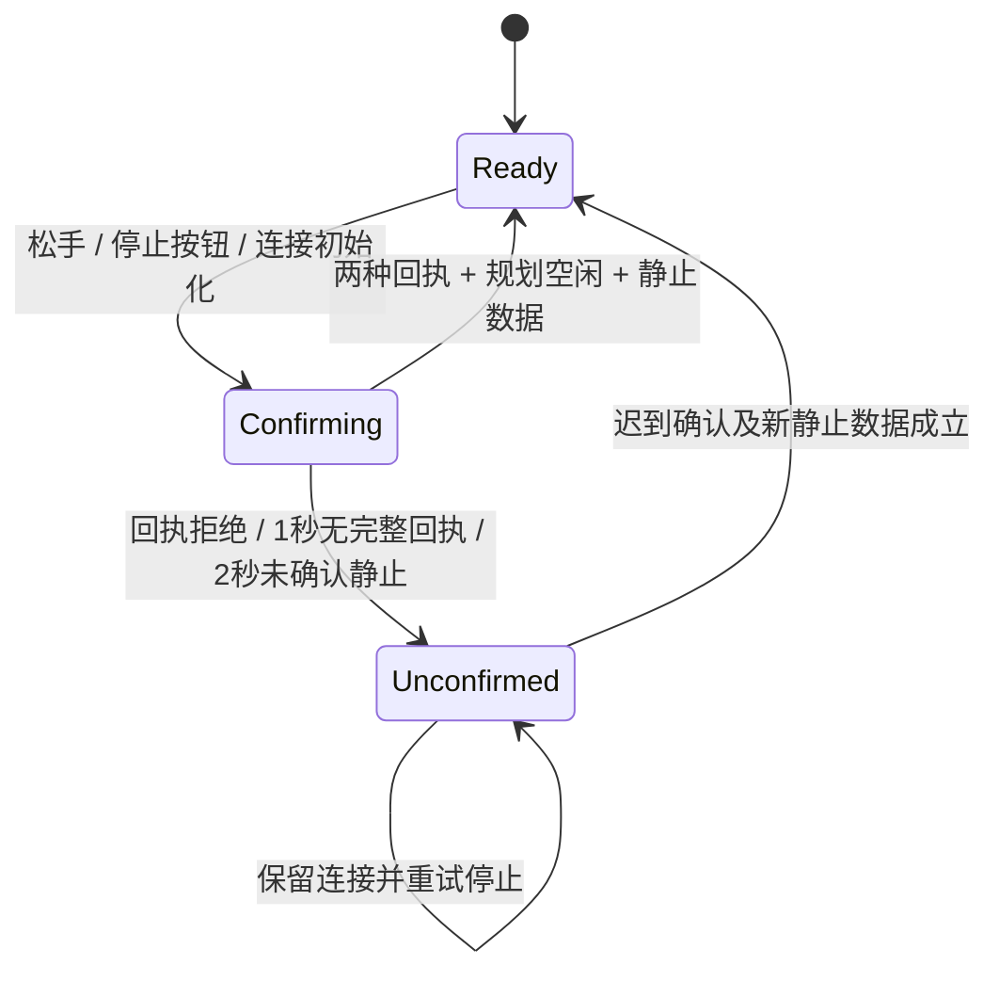

# RM65 1.15.4 试用版开发者技术文档

文档日期：2026-10-19。对应工程：`RM65_Merged_Control`。本文描述 1.15.4 的代码实现、接口和构建方式。

## 1. 版本与运行环境

| 项目 | 值 |
| --- | --- |
| 应用名称 | RM65 1.15.4 试用版 |
| 试用版 applicationId | `com.realman.rm65webview.trial1154` |
| 标准包 applicationId | `com.realman.rm65webview` |
| Kotlin namespace | `com.realman.rm65webview` |
| 启动 Activity | `com.realman.rm65webview.MainActivity` |
| versionName / versionCode | `1.15.4` / `30` |
| Android 最低版本 | API 26 |
| compileSdk / targetSdk | `35` / `35` |
| Java / Kotlin | Java 17 / Kotlin 2.0.21 |
| Android Gradle Plugin / Gradle | 8.7.3 / 8.9 |
| 默认机械臂地址 | `192.168.33.80:8080` |

应用由 Android 原生层和本地 WebView 页面组成，原生层直接使用 TCP JSON 协议与控制器通信。运行时没有官方 SDK、Python 服务或网页后端依赖。`org.json` 使用 Android 自带实现，单元测试另引入 JVM 版本。

现有固件采集样本为 `RM65-6FB`，`ctrl_info.version` 和 `plan_info.version` 均为 `V1.7.4`。该样本保存在工程上级目录的 `device-backup-20261016/controller-software-info.json`；运行时通过 `get_arm_software_info` 更新信息。

## 2. 架构与代码定位



原生源码目录为 `app/src/main/java/com/realman/rm65webview/`，页面资源位于 `app/src/main/assets/`。

| 文件 | 职责 |
| --- | --- |
| `MainActivity.kt` | WebView、JS Bridge、轮询、状态分发和各流程协调 |
| `RobotTcpClient.kt` | TCP 会话、发送队列、按行接收、写超时检查 |
| `RobotProtocol.kt` | JSON 命令构造、参数范围与协议整数换算 |
| `RobotModels.kt` | 快照模型、`RobotUpdate` 和 `RobotResponseParser` |
| `ManualTouchGuard.kt` | 原生触摸指针与按住操作的归属关系 |
| `ManualHoldLease.kt` | 带手势 ID 的心跳期限和单次按住时长 |
| `ManualStopGate.kt` | 停止回执、规划状态、关节静止确认及重试 |
| `EndpointStepGate.kt` | 固定距离步进的回执、完成事件和位移确认 |
| `CoupledBendFlow.kt` | J2/J3/J5 的等角度联动目标与执行检查 |
| `SavedResetPose.kt` | 复位姿态序列化及 `SavedResetFlow` |
| `GripperConnectionFlow.kt` | 末端供电读回、夹爪状态与检测恢复 |
| `GripperActionFlow.kt` | 单个夹爪动作的接收与完成判定 |
| `ActionModels.kt` / `ActionSession.kt` | 动作节点、录制草稿、去重和回放游标 |
| `ActionStore.kt` | 已保存动作的本地持久化 |
| `DragRecordingFlow.kt` | 拖动段开始、结束、保存和文件确认 |
| `PlaybackStepGate.kt` / `PlaybackControlFlow.kt` | 回放节点推进、暂停和继续确认 |
| `RobotAlarms.kt` / `AlarmClearFlow.kt` | 错误码描述、报警清除及结果复查 |
| `app.js` | 页面状态、触摸事件、按钮可用性及原生事件处理 |
| `action-domain.js` | 前端动作数据整理与展示辅助 |
| `pose3d.js` / `rm65-model.js` | Three.js 姿态视图和离线模型数据 |
| `preview-bridge.js` | 浏览器本地交互模拟 |

## 3. 线程与 TCP 会话

业务状态集中在 Android 主线程。JS Bridge 调用和 TCP 回复通过 `onMain` 切回主线程，再修改快照、推进状态机并推送页面事件。

| 执行单元 | 工作 |
| --- | --- |
| Android 主线程 | 25ms 调度、界面事件、业务状态和状态机 |
| `rm65-json-writer` | 单线程串行写入 TCP |
| `rm65-json-reader` | 接收并拆分 JSON 行，携带会话 ID 回调 |
| `rm65-write-watchdog` | 每 50ms 检查在途写入，默认写超时 3000ms |
| `rm65-hold-watchdog` | 每 50ms 检查按住信号；快速停止重试间隔 200ms |

`RobotTcpClient` 使用 `Socket`，连接超时 3000ms，启用 `tcpNoDelay` 和 `keepAlive`。传输编码为 UTF-8，每条 JSON 后追加 `\r\n`；接收端通过 `readLine()` 组装完整行，因此 TCP 包边界不参与业务判断。

发送队列按优先级、入队顺序排序：

| 优先级 | 指令 |
| --- | --- |
| 0 | 停止、暂停及相关拖动停止指令 |
| 1 | 普通非查询命令，包括运动、夹爪、配置和清错 |
| 2 | 名称以 `get_` 开头的查询 |

停止类指令入队时移除尚未执行的优先级 1 任务。在途写入由独立写超时检查处理；队列优先级不能中断已开始的 `flush()`。查询按 `sessionId:command` 对待发送任务去重，写出后解除去重标记；这与主线程的“等待回复”标记是两个层次。非停止命令入队时，队列达到 32 个任务会触发连接失败处理。

会话使用递增 `epoch`。接收回调和发送任务都核对会话及 Socket，旧连接的数据和待发任务不会进入新连接。应用没有自动重连，也不会在重连后重放运动指令。会话 ID 是客户端本地标识，不是控制器命令流水号。

## 4. 协议编码与回复解析

### 4.1 数值单位

| 数据 | TCP JSON 数值 | Kotlin / Bridge 数值 | 页面显示 |
| --- | --- | --- | --- |
| 六轴关节角、关节限位 | 角度 × 1000 的整数 | 度，`Double` | 度 |
| 末端 X/Y/Z | 米 × 1000000 的整数 | 米，`Double` | 毫米 |
| 末端 RX/RY/RZ | 弧度 × 1000 的整数 | 弧度，`Double` | 度 |
| 位置步进 `step` | 毫米 × 1000 的整数 | Bridge 输入毫米 | 毫米 |
| 速度 `v` | 整数百分比 | 1～30 | 百分比 |
| 夹爪 `actpos` / `current_force` | 原始整数 | 原样传递 | 位置值 / 以 g 标注的夹力值 |

关节数组按 J1～J6 排列，位姿数组按 `[x,y,z,rx,ry,rz]` 排列。编码使用乘法后 `toInt()` 截断，不是四舍五入。

### 4.2 命令与成功字段

解析器先识别 `state`，再识别 `command`，输出 `RobotUpdate` 子类型。核心命令的 ACK 按下表取对应的布尔字段；字段缺失或类型不符时为 `success=null`。

| 命令 | 成功字段 |
| --- | --- |
| `set_joint_teach` | `joint_teach` |
| `set_pos_teach` | `pos_teach` |
| `set_ort_teach` | `ort_teach` |
| `movej`、`set_pos_step` | `receive_state` |
| `set_stop_teach` | `stop_teach` |
| `set_arm_slow_stop` | `arm_slow_stop` |
| `set_arm_stop` | `arm_stop` |
| `set_teach_frame` | `set_state` |
| `clear_system_err` | `clear_state` |
| `set_joint_clear_err` | `joint_clear_err` |
| `start_drag_teach`、`stop_drag_teach` | `drag_teach` |
| `save_trajectory_file` | `save_state` |
| `set_run_trajectory_file` | 优先 `run_state`，否则 `start_state` |
| `set_gripper_release`、`set_gripper_pick_on`、`set_gripper_position`、`set_gripper` | `state` |

未单独配置的命令仍使用 `firstBoolean()` 兼容解析。新增协议接口时，构造方法位于 `RobotProtocol`，回复类型与成功字段位于 `RobotModels`。

当前状态支持 `state=current_arm_state` 和 `command=get_current_arm_state` 两种封装；全部状态同样支持 `arm_all_state` / `get_arm_all_state`。系统 `err` 可解析整数数组、数字或十进制数字字符串；缺失时为空数组。

`current_trajectory_state` 的 `device=0` 表示机械臂、`device=1` 表示夹爪，未给出时解析为 `-1`。`trajectory_file_state` 单独解析为轨迹文件完成事件。完成事件、命令 ACK 和状态查询分别处理。

解析异常记录为 `parse_error`，单条无效回复不会直接终止整个连接；运动流程随后依据状态时效和各自超时作出判断。

### 4.3 协议示例

J5 正向示教命令与回复：

```json
{"command":"set_joint_teach","teach_joint":5,"direction":"pos","v":5}
```

```json
{"command":"set_joint_teach","joint_teach":true}
```

示教停止与受控快速停止分别发送：

```json
{"command":"set_stop_teach"}
```

```json
{"command":"set_arm_stop"}
```

## 5. 连接初始化与轮询

应用启动后加载偏好设置、动作库和本地页面，连接由 `connect(host,port)` 显式触发。连接建立后的顺序为：

1. 初始化请求标记，启动快速停止确认。
2. 启动状态轮询及夹爪连接流程。
3. 请求实际关节上下限、示教参考系、软件信息和轨迹文件列表。
4. 根据回执与快照更新 `motion_ready`。

连接建立包含停止命令，不是纯查询握手。

| 内容 | 调度条件与间隔 |
| --- | --- |
| 主调度循环 | 25ms |
| 关节角 / 末端位姿 | 空闲 200ms；运动、停止确认、清错、拖动段或回放期间 50ms |
| 全部关节状态 | 500ms |
| 夹爪状态 | 动作中 150ms；状态就绪 1000ms；其他情况 500ms |
| 当前规划 | 回放等待或清错期间 500ms；停止确认期间 200ms |
| 工具 / 工作 / 示教参考系 | 5000ms；参考系切换期间另走确认流程 |
| 实际关节限位 | 尚未取得时每 2000ms 重查 |
| 末端供电查询 | 由 `GripperConnectionFlow` 调度，确认 24V 后每 5000ms 查询 |
| 一般状态请求等待 | 500ms 后允许再次查询 |
| 轨迹文件列表等待 | 5000ms |

这些数值是客户端调度间隔，实际发送还受 pending 标记和 TCP 队列合并影响。业务超时使用 `SystemClock.elapsedRealtime()`；动作 ID、保存时间和诊断日历时间使用 `System.currentTimeMillis()`。

## 6. JavaScript Bridge

页面通过 `window.RobotBridge` 访问原生对象。Bridge 方法异步触发原生流程，不返回机械臂执行结果；`app.js` 中 `nativeCall()` 返回的布尔值仅表示桥调用是否发起成功。

### 6.1 连接与配置

| 签名 | 功能 |
| --- | --- |
| `pageReady()` | 开启事件推送，并发送当前状态、动作库、录制、回放及轨迹目录 |
| `connect(host: String, port: Int)` | 保存地址、清理连接快照并建立 TCP |
| `disconnect()` | 请求停止并关闭当前 TCP |
| `saveConnectionSettings(host: String, port: Int)` | 保存地址，以 `connection_settings_saved` 确认结果 |
| `setTeachFrame(frame: Int)` | `0` 工作参考系，`1` 工具参考系；等待设置回执及读回 |
| `setJointSafetyConfig(configJson: String)` | 配置六轴 `minimum`、`maximum`、`margin` 数组 |
| `setJogWatchdog(enabled: Boolean, seconds: Int)` | 旧版兼容设置，范围 1～30 秒；页面入口已隐藏 |
| `addDesktopShortcut()` | 请求创建当前应用名称的快捷方式 |

已连接时不能把地址修改为另一个端点。`setTeachFrame` 的读回有效期为 12 秒，切换确认超时为 5 秒。

### 6.2 手动运动与夹爪

| 签名 | 功能 |
| --- | --- |
| `startJog(mode: String, axis: String, direction: Int, speed: Int, holdId: Int)` | 按住点动 |
| `jogHeartbeat(holdId: Int)` | 更新当前手势心跳 |
| `stopJog()` | 结束当前按住流程并进入停止确认 |
| `stopMotion()` | 无论本地是否标记运动，都请求示教停止和快速停止 |
| `stepPosition(axis: String, direction: Int, distanceMm: Double, speed: Int)` | 单次 1、5、10mm 位置步进 |
| `startCoupledBend(direction: Int, speed: Int, holdId: Int)` | J2/J3/J5 联动 |
| `saveResetPose()` | 保存当前六轴姿态 |
| `startSavedReset(speed: Int, holdId: Int)` | 按住返回保存姿态 |
| `gripperOpen()` / `gripperClose()` | 张开 / 持续力控夹取 |
| `refreshGripper()` | 重新检测末端供电和夹爪状态 |
| `initializeGripper()` | 显式发起初始化张开动作 |
| `copyGripperDiagnostics()` | 复制夹爪检测状态和近期事件 |

`mode` 为 `joint`、`position`、`orientation`；对应 `axis` 分别为字符串 `1`～`6`、`x/y/z`、`rx/ry/rz`。方向为 `-1` 或 `1`，速度为整数 1～30，`holdId` 由页面逐次递增。

### 6.3 动作、报警与诊断

| 签名 | 功能 |
| --- | --- |
| `startRemoteRecording(displayName: String, speed: Int)` | 建立遥控录制草稿并采集起点 |
| `startDragRecording(displayName: String, speed: Int)` | 建立拖动录制草稿并请求首段录制 |
| `finishDragSegment()` / `startNextDragSegment()` | 保存当前拖动段 / 开始下一段 |
| `insertActionWait(milliseconds: Int)` | 加入 100～60000ms 等待节点 |
| `finishActionRecording()` / `cancelActionRecording()` | 保存动作 / 取消草稿 |
| `resumeRecording()` | 恢复当前进程中中断的草稿 |
| `refreshControllerTrajectories()` | 查询控制器轨迹目录 |
| `importControllerTrajectory(controllerName: String, displayName: String, speed: Int)` | 将已有控制器文件绑定为本地动作 |
| `runAction(actionId: String, speed: Int)` | 对齐起点后回放动作 |
| `pauseAction()` / `resumeAction()` / `stopAction()` | 暂停 / 继续 / 停止回放 |
| `renameAction(actionId: String, displayName: String)` / `deleteAction(actionId: String)` | 修改本地动作库 |
| `copyDiagnostics()` | 复制最近一次回放中断诊断 |
| `refreshAlarms()` | 请求新系统及关节状态 |
| `clearAlarm(target: Int)` | `0` 清系统报警，`1`～`6` 清指定关节报警 |

### 6.4 原生推送事件

`sendEvent()` 将事件 JSON 转成字符串，再调用 `window.RM65App.onNativeEvent(jsonString)`。浏览器模拟桥也可以传入对象，页面入口兼容两种形式。

| `type` | 载荷 |
| --- | --- |
| `status` | `data` 包含连接、运动、停止、夹爪、限位、报警及快照 |
| `message` | 顶层 `message` 文本及 `error` 布尔值 |
| `connection_settings_saved` | `data.success`、`data.error` |
| `manual_hold_released` | `data.hold_id`，页面结束匹配的本地手势 |
| `action_library` | `data` 为已保存动作数组 |
| `recording` | `data=null` 或录制草稿及等待状态 |
| `playback` | `data.state`、节点索引、等待内容、暂停控制和最近中断信息 |
| `controller_trajectories` | `data` 文件数组；顶层 `loading/received/error/software_info` |

`status.data` 中开发时常用的字段：

| 字段 | 含义 |
| --- | --- |
| `connected` | 主线程观察到的 TCP 连接状态 |
| `motion_ready` / `motion_block_reason` | 基础运动条件及首个不满足的原因 |
| `jog_active` / `step_active` | 客户端手动运动意图 / 步进流程活动状态 |
| `manual_stop_pending` / `manual_stop_unconfirmed` | 正在确认停止 / 确认已超时或被拒绝 |
| `hold_signal_timeout_ms` / `hold_max_ms` | 固定心跳超时 / 单次按住时长 |
| `arm_state_age_ms` / `arm_state_sequence` | 位置快照年龄 / 本会话帧序号 |
| `arm.joint` / `arm.pose` | 六轴角度 / 六维末端位姿 |
| `joints.joint_en_flag` / `joint_err_code` / `system_error` | 使能、关节错误、位置快照中的系统错误 |
| `limits.joint_min/joint_max` | 控制器实际限位 |
| `limits.control_joint_min/control_joint_max` | 生效的软件范围 |
| `limits.joint_limit_margin_deg` | 各关节提前停止角度 |
| `gripper_busy` / `gripper_initializing` / `gripper_health` | 夹爪动作和检测状态 |
| `reset_pose_saved` / `reset_pose_label` / `reset_return_active` | 复位姿态保存情况与执行状态 |
| `coupled_bend_active` | 联动流程状态 |
| `alarms` | 报警有效性、明细和清除流程结果 |

`jog_active=false` 表示客户端按住流程已经结束，实际静止由 `manual_stop_pending` 的确认流程判断。`motion_ready` 也不是每个操作的最终可用性：手动操作还会检查录制、回放、夹爪动作、路点采集和参考系切换等互斥条件。

## 7. 手动控制与停止状态机

### 7.1 按住操作

网页在 `pointerdown` 时生成 `holdId` 并发起运动，每 150ms 发送该 ID 的心跳。`pointerup`、`pointercancel`、`lostpointercapture`、页面隐藏及失焦会结束本地手势。

原生 `dispatchTouchEvent()` 独立维护物理指针。`ManualTouchGuard.beginHold()` 仅接受一个未消费的主指针；松开后即使延迟的开始调用才到达，也不会建立新的按住操作。

`ManualHoldLease` 在独立线程检查：

- 距上次有效心跳达到 500ms：租约到期。
- 距开始按住达到 5000ms：本次按住结束。
- 心跳的 ID 不匹配或到达时已过期：不续期。

租约到期后独立线程发送示教停止与快速停止，并通知主线程进入相应确认流程。旧版 `jog_watchdog_enabled` 不影响该租约；复位和联动类中仍保留的 1500ms 检查属于内层检查。

### 7.2 停止确认



普通松手发送 `set_stop_teach` 和 `set_arm_slow_stop`；`stopMotion()`、连接初始化和异常升级使用 `set_stop_teach` 和 `set_arm_stop`。快速停止是协议运动控制命令，应用中没有独立的硬件急停接口。

`ManualStopGate.ready()` 的成立条件：

1. 示教停止和当前缓停 / 快停命令均取得有效 ACK。
2. 在两种 ACK 齐备后发起的规划查询返回 `type=none`，反馈年龄不超过 1000ms。
3. 六个关节相对固定参考角的差值均不超过 0.03°，至少 3 个不同帧，稳定跨度至少 300ms。
4. 最后一帧位置反馈年龄不超过 250ms。

超时后保留 `pending=true`，标记 `unconfirmed=true` 并升级快停；迟到的有效确认仍可在同一连接中完成流程。`ManualStopGate.commandsDue()` 前 2 秒每 200ms 可重发，之后每 1000ms 可重发；激活 `independentStopActive` 后，独立线程另外按 200ms 间隔重发示教停止与快停。

停止确认失败不会调用 `stopAndDisconnect()`。TCP 写入错误、远端关闭、队列过长等传输故障仍会关闭 Socket。显式 `disconnect()` 也会关闭连接。

生命周期行为：`onPause()` 请求停止手动运动和回放；`onStop()` 在停止确认尚未完成时保留连接，否则断开。后台保留的连接在随后确认成功时不会再追加一次断开。`onDestroy()` 清理线程、WebView 和 TCP。

### 7.3 限位与基础可执行条件

`motionProblem()` 检查连接、清错状态、停止确认、位置快照 1000ms 时效、系统错误、关节状态 1500ms 时效、使能、实际限位与软件配置。系统错误缺失和非零分别返回不同原因。

软件范围每轴优先使用保存值，否则使用控制器实际范围。对第 i 轴：

```text
有效目标区间 = [softwareMin[i] + margin[i], softwareMax[i] - margin[i]]
softwareMin[i] >= actualMin[i]
softwareMax[i] <= actualMax[i]
softwareMax[i] - softwareMin[i] > 2 * margin[i]
margin[i] ∈ [0°, 90°]，默认 10°
```

单关节进入边界区时，仅拦截继续靠近该边界的方向。笛卡尔点动在任一关节进入边界区时被拦截。运动中会重复检查当前状态与范围。

## 8. 位置步进、联动和复位

| 功能 | 实现与结束条件 |
| --- | --- |
| 位置步进 | `set_pos_step`，距离为 ±1/5/10mm；ACK、`device=0` 完成事件和新位姿共同确认；实际位移长度与目标相差不超过 0.25mm；15 秒超时 |
| J2/J3/J5 联动 | 构造单次 `movej`，三轴同方向、同角度；J1/J4/J6 保留起始角；各轴最多 10°，幅度按最近边界减 0.05° 后向内取整；可用幅度低于 0.5° 不生成计划 |
| 保存复位 | `SavedResetPose` 保存六轴角度和时间戳 |
| 按住复位 | 单次 `movej` 返回保存角度；已处于目标 ±0.05° 时不发送运动命令 |

联动与复位跟随顶部 1～30% 速度，使用 ACK、机械臂完成事件以及事件之后的两帧 ±0.05° 角度反馈判定到位。联动还检查三轴进度差不超过 0.5°，以及实际角度没有偏离起点和目标形成的范围超过 0.25°。

复位类的总完成超时为 120 秒，联动为 30 秒；实际按住流程仍受外层单次 5 秒租约约束。复位姿态不包含夹爪状态。

联动属于关节空间插值，不固定末端位置和朝向。当前版本没有接入自动奇异点规避或三维拖拽控制。

## 9. 夹爪状态与动作确认

`GripperConnectionFlow` 管理检测，`GripperActionFlow` 管理开合动作。检测就绪条件包括：最近 12 秒内确认 `voltage_type=3`、夹爪反馈不超过 3 秒、`status=1`、`enable=1`、`error=0`、`mode` 在 1～6。

供电查询单次等待 1000ms，连续三次超时后查询退避到 5000ms。读回供电类型不是 3 时，在没有运动、停止确认、清错、夹爪动作、录制和回放的空闲阶段，可发送一次 `set_tool_voltage` 将 `voltage_type` 设为 3，然后重新读回。该检测流程不发送开合命令。

| 动作 | 命令与默认参数 | 完成模式 |
| --- | --- | --- |
| 张开 | `set_gripper_release`，`speed=200, block=false` | `mode=1` |
| 闭合 | `set_gripper_pick_on`，`speed=500, force=200, block=false` | `mode=2` 或 `6` |
| 旧位置节点回放 | `set_gripper_position`，`block=false` | `mode∈{1,2,3,6}` 且位置差 ≤5 |

动作在匹配 ACK 后，取得至少两帧满足完成条件的状态，并持续至少 150ms，才返回 `Completed`。ACK 超时 5000ms、动作期间反馈超时 2000ms、动作总超时 20000ms。夹爪完成事件中的失败可直接结束流程，成功事件不会替代模式确认。

`busy` 期间拒绝重复开合请求。录制节点在动作完成后加入，相邻相同夹爪节点由 `ActionSession.addGripper()` 去重。手动页面仅保留开、关，协议层与数据模型仍保留旧 `POSITION` 节点兼容。

## 10. 动作录制、持久化与回放

### 10.1 数据格式

`ActionRecord` 的 JSON 示例：

```json
{
  "id": "A1700000000000",
  "display_name": "样例动作",
  "recording_type": "remote",
  "default_speed": 5,
  "nodes": [
    {"type":"waypoint","joints_deg":[0,-30,-60,0,-30,0],"controller_point_name":"A1700000000000P1","speed":5,"continuous":true},
    {"type":"gripper","operation":"close"},
    {"type":"wait","duration_ms":1000}
  ],
  "created_at": 1700000000000,
  "updated_at": 1700000001000
}
```

| 节点类型 | 主要字段 |
| --- | --- |
| `waypoint` | `joints_deg[6]`、`controller_point_name`、`speed`、`continuous` |
| `drag_trajectory` | `controller_name`、`point_count`、`start_joints_deg`、`end_joints_deg`、`minimum_joints_deg`、`maximum_joints_deg`、`verified` |
| `gripper` | `operation=open/close/position`，位置节点另含 `position` |
| `wait` | `duration_ms`，范围 100～60000 |

`continuous` 和路点 `speed` 保留在序列化格式中；当前回放按节点串行，使用本次 `runAction` 的速度，并以 `r=0, trajectory_connect=0` 发送 `movej`。

### 10.2 遥控录制

开始录制时采集当前起点；普通点动结束后，先等待停止确认，再从更新的帧序号采集路点。固定步进在到位后采集，取消中的步进不保存未确认路点。联动和按住复位当前不参与录制。

新路点与最近一个路点逐轴比较，六轴差值均小于 0.05° 时不重复加入。节点本地保存六轴角，同时以 `${actionId}P${index}` 名称请求 `add_global_waypoint` 写入控制器。该控制器写入不是本地节点提交的事务回执屏障。

草稿仅保存在当前进程的 `ActionSession` 中。断联设置中断标记，重连后可通过 `resumeRecording()` 恢复；进程退出不会持久化未完成草稿。保存动作至少包含一个机械臂路点或拖动节点。

### 10.3 拖动录制

`DragRecordingFlow` 的阶段为：

```text
IDLE → STARTING → RECORDING → STOPPING → SAVING → VERIFYING → IDLE
                           任一确认失败或超时 → FAILED
```

发送顺序为 `start_drag_teach(trajectory_record=1)`、`stop_drag_teach`、`save_trajectory_file`、`get_trajectory_file_list`。开始 / 停止 ACK 超时各 5 秒，保存 ACK 超时 10 秒，文件确认超时 10 秒，确认期间每 500ms 可重新查列表。仅找到名称匹配且 `point_num>0` 的文件后加入动作节点。

目录维护 `loading`、`received`、`error` 三个独立状态。只有成功收到列表时，空数组才表示没有文件。文件保存与列表接口按实际固件回复判断，超时不转换为空目录。

拖动文件保存在机械臂控制器，本地动作仅保存名称引用及采集到的关节起止值、范围。导入已有文件时，当前关节角作为其起点，范围和终点留空，`verified=false`。取消或删除本地动作保留控制器拖动文件；关联的控制器全局路点在已连接时请求删除。

### 10.4 回放

回放状态为 `IDLE → ALIGNING → RUNNING ↔ PAUSED → IDLE`。先寻找首个运动节点的起点，以 `min(10, requestedSpeed)` 发送对齐 `movej`，到位后从动作游标开始顺序执行。

| 节点 | 推进条件 |
| --- | --- |
| 普通路点 / 对齐 | 匹配 ACK、目标角度误差 ≤0.1°、至少两帧稳定 150ms、规划 `none`；角度与规划反馈不超过 1000ms |
| 拖动文件 | 文件运行 ACK 和匹配的轨迹文件成功完成事件 |
| 夹爪 | `GripperActionFlow.Completed` |
| 等待 | 主线程定时器到期 |

`PlaybackStepGate` 的 ACK 超时为 5 秒，节点总完成超时为 15 分钟。普通路点推进不强制要求完成事件，使用实际角度和规划状态确认；拖动文件分支依赖文件完成事件。

暂停 / 继续通过 `PlaybackControlFlow` 分别确认，超时 5 秒。暂停等待节点会保存剩余时间；暂停夹爪节点只暂停后续节点推进。回放失败保存诊断，重置游标并进入停止确认，连接保持；再次执行从重新对齐起点开始。

## 11. 报警读取与清除

`alarms.items` 合并位置快照和全部状态中的系统错误，过滤零值、按代码去重，再加入逐关节错误。`RobotAlarms` 按精确代码查表，未知代码保留原值；关节代码 `0xF000` 单独解释为通信丢帧，不拆成多个位。

`alarms.known` 依赖连接、系统错误字段存在、至少六个关节错误值，以及位置 / 全部状态各自的时效。断联后可继续显示上次快照，但 `known=false`、清除入口不可用。`joints.system_error` 仅来自位置快照，而报警列表合并两种系统错误来源。

清除流程为 `IDLE → CHECKING → WAIT_ACK → VERIFYING → IDLE`：

1. `CHECKING` 收集开始之后查询的新角度、全部状态和规划；规划为空、至少三帧相对参考角变化不超过 0.03° 且稳定跨度达到 300ms 后发送一次清错。
2. `WAIT_ACK` 等待 `clear_state` 或 `joint_clear_err` 的有效布尔回执。
3. `VERIFYING` 丢弃先前证据，重新查询。至少取得两次新全部状态；目标报警仍存在时返回失败，目标无报警且位置反馈计数满足时返回成功。

系统清除检查两份系统错误均为零；单关节清除检查目标关节，不把其他报警算作该关节清除失败。每个阶段的等待上限为 6 秒。清除结果不触发运动、上使能或自动继续回放。

## 12. 本地存储

偏好文件统一名为 `rm65`，实际路径为各 applicationId 沙箱中的 `shared_prefs/rm65.xml`。

| 键 | 内容 |
| --- | --- |
| `ip` / `port` | 控制器地址 |
| `endpoint_address_migrated` | 旧默认地址迁移标记 |
| `joint_1_control_min`～`joint_6_control_min` | 软件最小角，字符串数值 |
| `joint_1_control_max`～`joint_6_control_max` | 软件最大角，字符串数值 |
| `joint_1_stop_margin`～`joint_6_stop_margin` | 提前停止角，字符串数值 |
| `saved_reset_pose_v1` | `{"version":1,"joint":[...],"saved_at":...}` JSON 字符串 |
| `action_library_v1` | `ActionRecord` JSON 数组字符串 |
| `last_playback_failure` | 最近回放中断诊断 JSON |
| `jog_watchdog_enabled` / `jog_watchdog_ms` | 旧心跳检查兼容设置 |
| `shortcut_requested` | 是否已发起过快捷方式请求 |

`ActionStore.list()` 忽略无法解析的单个动作，按 `updated_at` 倒序返回。保存时按 ID 替换，重命名更新 `updated_at`。标准包和试用包的数据独立；两者的动作、设置和复位姿态不会自动同步。

## 13. 页面与三维视图

页面从 `file:///android_asset/index.html` 加载，JavaScript 开启，DOM Storage 关闭。WebView 禁止跨文件来源访问和任意页面导航；渲染依赖与模型都打入 APK。

`pose3d.js` 根据收到的六轴角更新离线模型。视图操作仅改变相机，包含单指旋转、双指缩放和预设观察方向；模块不访问 `RobotBridge`。关节标识分为 J2/J3/J5 弯曲组与 J1/J4/J6 旋转组，投影标签由模型关节位置生成。三维初始化失败时保留二维 Canvas 视图。

`preview-bridge.js` 只在没有原生 Bridge 且 URL 包含 `?preview=1` 时注入模拟桥。模拟用于页面交互，不执行控制器通信，也不覆盖 Android 注入对象。

## 14. 构建、安装与共存包

在工程目录执行：

```sh
./gradlew -PsideBySide=true :app:assembleDebug :app:testDebugUnitTest
node --test tests/*.test.js
```

APK 输出为 `app/build/outputs/apk/debug/app-debug.apk`。两种构建共用该输出路径，文件名本身不区分包名；试用版分发文件重命名为 `RM65_v1.15.4_side_by_side_debug.apk`。

`sideBySide=true` 修改 `applicationId` 和 Manifest 的 `appLabel`，不修改 Kotlin namespace，所以 Activity 的完整类名仍属于 `com.realman.rm65webview`。

```sh
adb -s DEVICE_SERIAL install RM65_v1.15.4_side_by_side_debug.apk
adb -s DEVICE_SERIAL shell am start -W -n com.realman.rm65webview.trial1154/com.realman.rm65webview.MainActivity
adb -s DEVICE_SERIAL shell dumpsys package com.realman.rm65webview.trial1154
```

已安装同一试用包时，以 `adb install -r` 更新该试用包。省略 `-PsideBySide=true` 构建的是标准 applicationId。

签名配置在工程上级存在 `.android-signing/rm65-debug.keystore` 时复用该文件，否则使用 Android 默认 debug 签名；更新同一 applicationId 时签名需一致。`local.properties` 在开发机指定 SDK 路径，不随源码包分发。

现有试用分发包 SHA-256：

```text
5127f820bbc46900bc3bd58a792f4d09f05eed5d7ca4ce4b3cd468ab8165b82d
```

该指纹对应已分发文件，不作为重新构建必须复现的结果。

## 15. 测试与调试入口

1.15.4 的发布验证记录包含 134 项 Kotlin/JUnit 测试、60 项 Node 测试。TCP 测试使用 `127.0.0.1` 上的模拟控制器；发布记录没有包含实机运动和清错结果。

| 测试位置 | 范围 |
| --- | --- |
| `ManualTouchGuardTest` / `ManualHoldLeaseTest` | 指针归属、延迟调用、心跳过期和手势隔离 |
| `ManualStopGateTest` / `RobotTcpClientTest` | 双回执、静止判定、超时重试、同会话恢复、队列及连接隔离 |
| `EndpointControlTest` / `CoupledBendFlowTest` / `SavedResetPoseTest` | 步进、联动计划与复位 |
| `GripperConnectionFlowTest` / `GripperActionFlowTest` | 供电读回、在线时效、开合完成与重复操作 |
| `DragRecordingFlowTest` / `PlaybackStepGateTest` / `PlaybackControlFlowTest` | 拖动保存、节点推进、暂停和继续 |
| `AlarmClearFlowTest` / `RobotActionProtocolTest` | 清错读回、ACK 字段与协议封装 |
| `ActionModelsTest` / `ActionSessionTest` | 节点格式、去重与草稿 |
| `tests/*.test.js` | 页面 Bridge 调用、按钮状态、连接表单、报警及三维模型 |

原生测试报告位于 `app/build/reports/tests/testDebugUnitTest/index.html`。`trace()` 保存最近 40 条内存事件，包括 ACK、完成事件、解析错误、停止请求 / 确认、按住过期、夹爪检测和报警清除结果。

`copyDiagnostics()` 读取 `last_playback_failure`，包含动作 / 节点、等待命令、接收状态、目标角、规划状态与年龄、控制器软件信息、TCP 会话、系统 / 关节错误和近期事件。`copyGripperDiagnostics()` 提供末端供电、在线状态及相关事件。两者通过页面点击复制到系统剪贴板。

本版本没有单独持久化所有手动点动的连续报文日志。排查时可按以下顺序定位：

| 现象 | 对应状态与源码 |
| --- | --- |
| 已连接但按钮不可用 | `motion_block_reason`、`manualControlProblem()`、`endpointControlProblem()` |
| 松手后持续等待 | `manual_stop_pending/unconfirmed`、两类 ACK、规划请求时间、角度帧序号 |
| 夹爪偶发不可用 | `gripper_health.code/age_ms`、供电读回时间、`mode/error` |
| 回放不进入下一节点 | `playback.waiting_for/control_pending`、`PlaybackStepGate`、夹爪完成状态 |
| 轨迹列表为空或保存未完成 | `controller_trajectories.received/error`、`DragRecordingFlow.phase` |
| 新包安装后出现空动作库 | 实际 applicationId、对应沙箱中的 `action_library_v1` |

## 16. 扩展接口的修改路径

新增控制器命令通常涉及 `RobotProtocol` 编码、`RobotModels` 解析、对应流程类和 `MainActivity` 调度，再通过 Bridge 或状态事件接入页面。这样新增字段的单位、ACK 与完成条件有明确归属。

扩展动作节点时，对应修改 `ActionNode.fromJson()/toJson()`、录制提交、`executePlaybackNode()`、`action-domain.js` 展示及序列化测试。改变持久化格式时，优先新增版本键或保留旧字段解码；当前位置夹爪节点就是通过兼容解码继续使用。

其他细节说明见 [动作数据](ACTION_MEMORY.md)、[回放实现](PLAYBACK_ROBUSTNESS.md)、[三维模型来源](RM65_MODEL_SOURCE.md)。这些文件包含历史版本说明；本文的 Bridge 签名、停止行为和构建身份以 1.15.4 实现为准。
